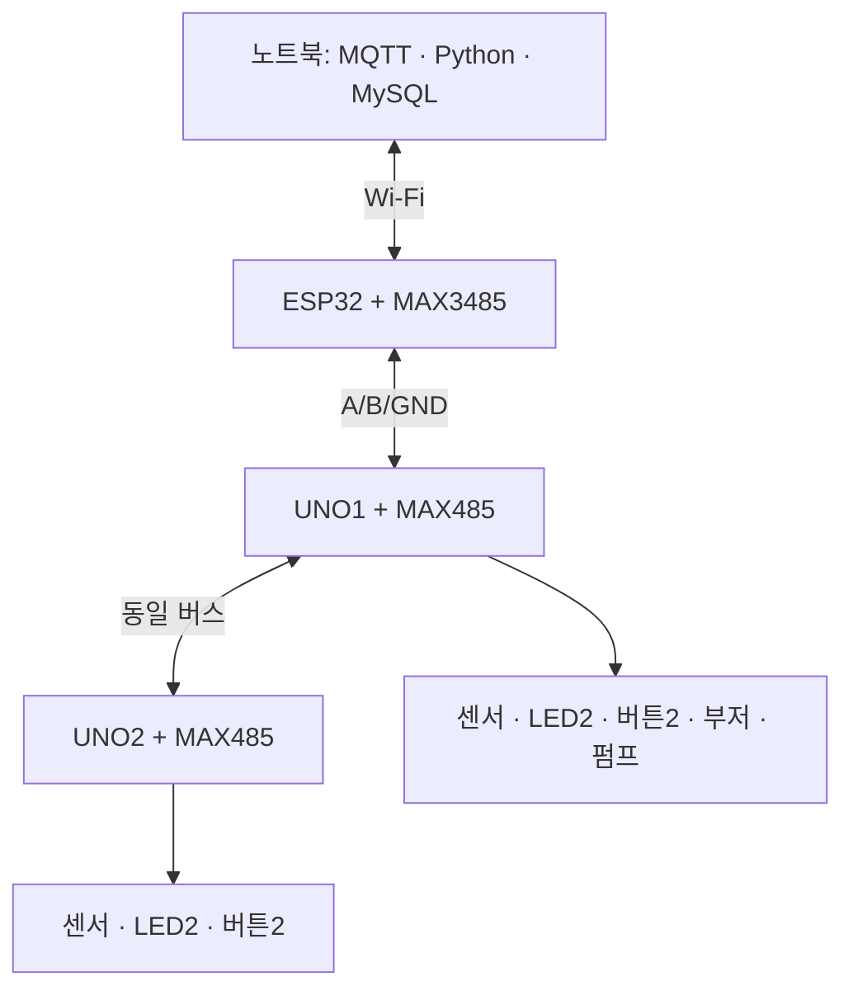

# 부품 및 배선

| 부품 | 수량 |
|---|---:|
| ESP32 DevKit V3 | 1 |
| UNO | 2 |
| MAX3485 3.3V | 1 (ESP32) |
| MAX485 5V | 2 (각 UNO) |
| 아날로그 토양수분 센서 | 1~2 (모델 미확인) |
| LED / 330Ω 저항 | 각 4 |
| 버튼 | 4 |
| 소형 수동 피에조 부저 | 1 |
| 3.3V 펌프 | 1 (UNO1) |
| 논리레벨 N-MOSFET / 100Ω / 10kΩ / 플라이백 다이오드 | 각 1 |
| 펌프용 별도 안정화 3.3V 전원 | 1 (기동전류에 맞춰 선정) |
| 120Ω 종단 | 전체 버스 양 끝 각 1 |

## ESP32와 MAX3485

| ESP32 | MAX3485 |
|---|---|
| 3V3 / GND | VCC / GND |
| GPIO17 TX2 | DI |
| GPIO16 RX2 | RO |
| GPIO25 | DE와 /RE 공통 |

일반 ESP32에서 GPIO16/17 사용을 가정합니다. DevKit V3라는 판매명만으로 사양은 확정되지 않으며 PSRAM 보드 등은 핀 사용 가능 여부를 확인하세요.

## UNO 각각

| UNO | 연결 |
|---|---|
| 5V / GND | MAX485 VCC / GND |
| D10 RX / D11 TX | RO / DI |
| D2 | DE와 /RE 공통 |
| A0 | 토양센서 AO (센서 전원 정격 확인) |
| D4 / D5 | 각 330Ω → LED 애노드, 캐소드 GND |
| D7 / D8 | 각 버튼 → GND, INPUT_PULLUP |
| D6 | MOSFET 게이트 100Ω 경유, UNO1만 사용 |
| D9 | 수동 피에조 부저 +, 부저 - GND, UNO1만 |

버튼1: 펌프 정지 + LED1 전환, UNO1에서는 짧은 부저 알림. 버튼2: LED2 전환.
큰 전류의 전자기 부저에는 별도 트랜지스터 드라이버가 필요합니다.
센서 1개이면 UNO1만 연결하고 UNO2의 미연결 A0 값은 사용하지 않습니다.
구역2 펌프 제어는 확장용 출력 상태이며 현재 실제 펌프는 UNO1에만 연결합니다.

## RS-485

ESP32→UNO1→UNO2 순으로 직선 배선: A↔A, B↔B, GND 공통.
종단 120Ω는 물리적 양 끝에만 설치합니다. 모듈 내장 종단이 있으면 중간 모듈의 종단은 제거합니다.
유휴 바이어스는 한 위치에서만 구성하고, 내장 바이어스와 전원 전압을 확인하세요.
모듈마다 A/B 표기가 다를 수 있습니다. 데이터시트로 검증하세요.
ESP32에 5V MAX485 RO를 직접 연결하지 않습니다.

## 펌프 MOSFET 회로

| 단자 | 연결 |
|---|---|
| 외부 3.3V + | 펌프 + |
| 펌프 - | MOSFET Drain |
| Source | 외부 전원 GND + UNO GND |
| Gate | UNO D6 → 100Ω → Gate |
| Gate–Source | 10kΩ 풀다운 |
| 다이오드 캐소드(띠) | 펌프 + |
| 다이오드 애노드 | 펌프 - |

보드의 3.3V 핀에서 모터 전원을 공급하지 않습니다. 기동/스톨 전류를 확인하여 전원·MOSFET·다이오드 용량을 선택합니다.
MOSFET은 Vgs=5V에서 충분히 켜지는 제품을 사용하고 패키지의 G/D/S 배열을 확인합니다.
전원 분리 상태에서 배선하고 펌프 대신 LED로 먼저 출력 시험합니다.
